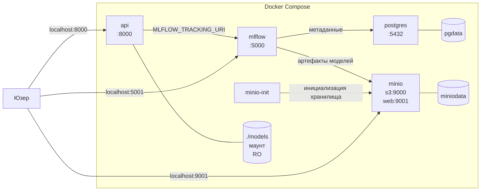

# Churn MLOps — стартовый шаблон


Это заготовка сквозного проекта курса. Здесь вы работаете весь семестр:
к декабрю из неё вырастет ML-сервис с пайплайном, тестами, CI/CD и мониторингом.

## Что делать прямо сейчас

```bash
python -m venv .venv
source .venv/bin/activate          # Windows: .venv\Scripts\Activate.ps1
make install
make check                         # должно напечатать environment: OK
make data                          # сгенерирует data/raw/churn.csv
```

Если `make check` печатает `FAIL` — читайте [../docs/setup.md](../docs/setup.md).

## Что уже готово, а что делаете вы

| Готово | Ваша работа |
|---|---|
| `src/config.py` — загрузка `params.yaml` | `src/data/prepare.py` |
| `src/logging_setup.py` — логирование | `src/features.py` |
| `src/data/generate.py` — генерация данных | `src/train.py` |
| `Makefile`, `params.yaml`, `.gitignore` | всё остальное, занятие за занятием |

Генерация данных отдана готовой намеренно: предмет курса — не выдумывание
датасета, а инженерия вокруг модели.

## Отправная точка

Файл [`notebooks/baseline_notebook.py`](notebooks/baseline_notebook.py) — это
реальный код «как из ноутбука»: работает у автора и больше нигде.
Первое занятие целиком про то, чтобы превратить его в воспроизводимый модуль.

## Правила проекта

1. **Никаких абсолютных путей.** Только `src.config.resolve()`.
2. **Никаких магических чисел в коде.** Всё числовое — в `params.yaml`.
3. **Данные и модели не коммитятся в Git.** С занятия 4 — в DVC.
4. **Секреты — только через переменные окружения.** `.env` уже в `.gitignore`.
5. **Работа идёт через ветки и Pull Request.** С занятия 2.

## Куда это вырастет

`../docs/syllabus.md` — план всех 18 занятий и артефакт каждого из них.

## Данные
Версионированные данные хранятся на локальном S3 хранилище

Для настройки dvc:
```
dvc remote modify --local minio access_key_id <access_key>
dvc remote modify --local minio secret_access_key <access_password>
dvc pull
```

## Почему .dvc надо коммитить

В .dvc хранится источник версионирования данных в виде хешей по конкретным коммитам. При настройке проекта с нуля доступна история того, с какими конкретно данными работала конкретная версия проекта.

Датасет может быть слишком большой по объему, а его хранение в гите не рациональным.
Без dvc при отсутсвии датасета версионирование кода будет отдельно от версионирования данных, в таком случае будет трудно понять с какими данными работала конкретная версия проекта.

## Если убрать features.py из deps стадии train

Наличие файла в deps говорит пайплайну о необходимости запустить этап при изменении в этом файле. 

Если features.py не будет в зависимостях, его изменения не стригерят новое обучение модели. Это хуже, чем ошибка, так как проблема неявная: мы не сможем определить ее наличие, не посмотрев сам код и запуск пайплайнов.

## Зачем логировать версию данных в mlflow

Эксперимент может быть выполнен на данных, которые еще не были связаны с текущим коммитом. Наличие хеша данных помогает убедиться в этом.

Если мы прогнали пайплайн и создали новые данные, хеш обновится и запуск эксперимента сохранит этот новый хеш. И тогда мы поймем, что есть несовпадение м-у хешем данных в эксперименте и хешем данных в коммите.


## Какая модель выбрана

Выбранная модель:
```
logreg:
    C: 0.5
    max_iter: 1000
```

Модель выбрана по максимальному ROC-AUC на валидационной выборке.

Порог выбран по сбалансированному соотношению м-у precision и recall ч-з скрипт:
```
>> python -m scripts.find_threshold
лучший порог: 0.245  (F1=0.541, precision=0.448, recall=0.682)
```
В реальных условиях порог был бы подобран в зависимости от того, какая метрика приоритетнее: precision или recall.

## Покрытие тестами

```bash
>> python -m pytest --cov=src --cov-report=term-missing

--------- coverage: platform darwin, python 3.11.15-final-0 ----------
Name                          Stmts   Miss  Cover   Missing
-----------------------------------------------------------
src/__init__.py                   0      0   100%
src/config.py                    35     15    57%   34-35, 45-54, 61-66, 70-71
src/data/__init__.py              0      0   100%
src/data/generate.py             53     17    68%   35-37, 98-112, 118
src/data/prepare.py              39      1    97%   88
src/data/validate.py             24     24     0%   1-48
src/evaluate.py                  54     38    30%   33-48, 60-92, 96
src/features.py                  13      0   100%
src/logging_setup.py              8      0   100%
src/service/__init__.py           0      0   100%
src/service/model_loader.py      66     66     0%   1-103
src/smoke_check.py               33     33     0%   3-47
src/tracking.py                  42     42     0%   1-64
src/train.py                     79     47    41%   40-43, 58-63, 76, 80, 92-144, 148
-----------------------------------------------------------
TOTAL                           446    283    37%

24 passed, 51 warnings in 0.47s
```


Покрытие `src` в 37%. Низкое покрытие связано с исключением из тестов CLI обработки и интеграций с сторонними сервисами. Интеграция с сторонними сервисами требует их активность во время тестов и наличие локальных артефактов. Для них нужны отдельные интеграционные тесты.

## Почему проверка pytest в CI полезнее pre-commit

Локальная проверка через pre-commit не гарантирует корректную работу в продакшене, так как проверка проходит на локальном проекте, у которого может быть измененное состояние среды.

Проверка в CI гарантирует корректную работу проекта на сконфигурированной с нуля среде.

## Проверка работы CI
- [Завышенный min_roc_auc](https://github.com/atheostheos/mlops-galiev-2026/pull/11)
- [Некорректный код](https://github.com/atheostheos/mlops-galiev-2026/pull/13)

## Кеширование проверок в CI

Первый прогон:
- quality in 1m 19s
- pipeline in 1m 19s
Второй прогон:
- quality in 1m 19s
- pipeline in 1m 18s

Время не измененилось, но скорее всего кеширование использовалось уже на первом прогоне

Часть записанных логов со второго прогона, кеширование используется:
```bash
...
Collecting numpy<3.0,>=1.26 (from -r requirements.txt (line 3))
  Using cached numpy-2.4.6-cp311-cp311-manylinux_2_27_x86_64.manylinux_2_28_x86_64.whl.metadata (6.6 kB)
Collecting pandas<3.0,>=2.1 (from -r requirements.txt (line 4))
  Using cached pandas-2.3.3-cp311-cp311-manylinux_2_24_x86_64.manylinux_2_28_x86_64.whl.metadata (91 kB)
...
```

## Скорость обработки 100 отдельных запросов и 1 батча

```bash
>> curl -s -o /dev/null -w 'Total: %{time_total}s\n' \
  -X POST http://localhost:8000/predict/batch \
  -H 'Content-Type: application/json' \
  --data-binary "$(python -c 'import json; c=json.load(open("examples/request.json")); print(json.dumps({"items":[c]*100}))')"

Total: 0.004913s

>> time sh -c '
for i in $(seq 1 100); do
  curl -s -o /dev/null -X POST http://localhost:8000/predict \
    -H "Content-Type: application/json" \
    -d @examples/request.json
done
'

sh -c   0.19s user 0.20s system 45% cpu 0.869 total
```

Итого: 0.005 сек за один батч и 0.869 сек за 100 отдельных запросов. Задержка связана с повторным исполненинем сетевых запросов, эндпоинта + отработки модели.

## Контракт API

Локальный адрес сервиса: `http://localhost:8000`. Интерактивная документация доступна по эндпоинту `/docs`.

Запуск сервиса:
```bash
make serve
```

Для трейса запросов используется `X-Request-ID`. Заголовок можно передать в запросе, чтобы использовать свой идентификатор, иначе создается новый. Полученные хедэр передается в ответе.

### Эндпоинты

| Эндпоинт | Тело | Пример ответа |
|---|---|---|
| `GET /health` | - | `{"status":"ok","model_loaded":true,"model_version":"local:<version>"}` |
| `POST /predict` | Customer | `{"churn_probability":0.42,"churn":1,"threshold":0.245,"model_version":"local:<version>"}` |
| `POST /predict/batch` | `{"items":[Customer, ...]}`. От 1 до 1000 клиентов | `{"count":1,"predictions":[{"churn_probability":0.42,"churn":1,"threshold":0.245,"model_version":"local:<version>"}]}` |
| `POST /explain` | Customer | `{"method":"linear_contribution","contributions":[{"feature":"...","contribution":0.12}],"model_version":"local:<version>"}`. Возвращает пять признаков, отсортированных по модулю веса в предсказании |
| `POST /reload` | - | `{"status":"ok","model_loaded":true,"model_version":"local:<version>"}` |

### Коды ответов

| Код | Значение |
|---|---|
| `200` | Запрос обработан. `/health` может вернуть `degraded`, если процесс работает, но модель не загружена |
| `422` | Некорректное тело запроса: отсутствует обязательное поле, значение вне диапазона, неизвестная категория или неверный размер батча |
| `503` | Модель не загружена |
| `500` | Непредвиденная ошибка |

### Схема объекта Customer

| Поле | Тип и ограничения |
|---|---|
| `tenure_months` | инт от 0 до 200 |
| `monthly_charges` | флоат от 0 до 1000 |
| `total_charges` | опциалнальный флоат >=0 |
| `contract_type` | `month-to-month`, `one_year`, `two_year` |
| `internet_service` | `fiber`, `dsl`, `none` |
| `payment_method` | `electronic_check`, `mailed_check`, `bank_transfer`, `credit_card` |
| `num_support_calls` |инт от 0 до 100 |
| `has_tech_support` | инт, 0 или 1 |
| `is_senior` | инт, 0 или 1 |
| `avg_monthly_gb` | флоат от 0 до 5000 |

Пример запроса:

```json
{
  "tenure_months": 24,
  "monthly_charges": 75.5,
  "total_charges": 1812.0,
  "contract_type": "one_year",
  "internet_service": "fiber",
  "payment_method": "electronic_check",
  "num_support_calls": 2,
  "has_tech_support": 1,
  "is_senior": 0,
  "avg_monthly_gb": 250.0
}
```

## Docker

### Фиксирование базового образа

Для повторяемости сборки при сборке хеши базовых образов зафиксированы. Этим гарантируется, что при повторной сборке не подтянется новая версия образа с тем же тегом, в котором новая среда ломает сервис. 
При наличии новых найденных уязвимостей потребуется вручную обновлять версию образа и фиксировать новый хеш, но зато с дргой стороны есть воспроизводимость и остуствие непредвиденных ошибок. 

### Контекст сборки с .dockerignore

Вместе с `.dockerignore` контекст сборки меньше 5мб

```bash
=> [internal] load .dockerignore                                                 
=> => transferring context: 183B
=> [internal] load build context 
=> => transferring context: 3.03kB
```

### Найденные уязвимости

[Отчет о найденных уязвимостях](reports/trivy-report.txt)

Среди уязвимости нет CRITICAL, все HIGH.

Среди них большая связана с базовый debian образом. Все из них, кроме zlib1g, еще не пофикшены. Версия не обновлена, так как библиотека не используется в сервисе.

Найдено две 2 уязвимости библиотек питона. Исходные версии оставлены для сохранения совместимости библиотек м-у собой.

### Размеры образов после оптимизации

|IMAGE | DISK USAGE | CONTENT SIZE |
|------|------------|--------------|
|churn-service:base | 3.37GB | 769MB |       
|churn-service:ignore | 3.37GB | 769MB |                       
|churn-service:slim | 2.39GB | 514MB |
|churn-service:multistage | 1.96GB | 410MB | 
|churn-service:local | 767MB | 162MB |

Размер образа после добавления .dockerignore не изменился, так как базовый образ изначально копировал только нужные файлы. Это повлияло только на контекст сборки.

### Слои образа

```bash
>> docker history churn-service:local

IMAGE          CREATED             CREATED BY                                      SIZE      COMMENT
dcc01b6f941d   About an hour ago   CMD ["uvicorn" "src.service.app:app" "--host…   0B        buildkit.dockerfile.v0
<missing>      About an hour ago   HEALTHCHECK &{["CMD-SHELL" "python -c \"impo…   0B        buildkit.dockerfile.v0
<missing>      About an hour ago   EXPOSE [8000/tcp]                               0B        buildkit.dockerfile.v0
<missing>      About an hour ago   USER appuser                                    0B        buildkit.dockerfile.v0
<missing>      About an hour ago   ENV PYTHONUNBUFFERED=1 PYTHONDONTWRITEBYTECO…   0B        buildkit.dockerfile.v0
<missing>      About an hour ago   COPY models/ ./models/ # buildkit               24.6kB    buildkit.dockerfile.v0
<missing>      About an hour ago   COPY params.yaml ./params.yaml # buildkit       12.3kB    buildkit.dockerfile.v0
<missing>      About an hour ago   COPY src/ ./src/ # buildkit                     315kB     buildkit.dockerfile.v0
<missing>      About an hour ago   COPY /install /usr/local # buildkit             437MB     buildkit.dockerfile.v0
<missing>      About an hour ago   WORKDIR /app                                    8.19kB    buildkit.dockerfile.v0
<missing>      About an hour ago   RUN /bin/sh -c useradd --create-home --uid 1…   69.6kB    buildkit.dockerfile.v0
<missing>      5 days ago          CMD ["python3"]                                 0B        buildkit.dockerfile.v0
<missing>      5 days ago          RUN /bin/sh -c set -eux;  for src in idle3 p…   16.4kB    buildkit.dockerfile.v0
<missing>      5 days ago          RUN /bin/sh -c set -eux;   savedAptMark="$(a…   52.1MB    buildkit.dockerfile.v0
<missing>      5 days ago          ENV PYTHON_SHA256=9120e0a653868f6e3698d36cdd…   0B        buildkit.dockerfile.v0
<missing>      5 days ago          ENV PYTHON_VERSION=3.11.18                      0B        buildkit.dockerfile.v0
<missing>      5 days ago          ENV GPG_KEY=A035C8C19219BA821ECEA86B64E628F8…   0B        buildkit.dockerfile.v0
<missing>      5 days ago          RUN /bin/sh -c set -eux;  apt-get update;  a…   4.97MB    buildkit.dockerfile.v0
<missing>      5 days ago          ENV LANG=C.UTF-8                                0B        buildkit.dockerfile.v0
<missing>      5 days ago          ENV PATH=/usr/local/bin:/usr/local/sbin:/usr…   0B        buildkit.dockerfile.v0
<missing>      5 days ago          # debian.sh --arch 'arm64' out/ 'trixie' '@1…   110MB     debuerreotype 0.17
```

Самый тяжелый слой - копирование среды. Следует уделять внимание наличию лишних библотек и не раздувать образ лишними зависимостями. Это согласуется и с этапами оптимизации: после использования `requirements-service.txt` размер образа уменьшился в 2.5 раза.

## Compose

### Схема тенда



### Ограничение ресурсов

```bash
>> docker stats
CONTAINER ID   NAME                     CPU %     MEM USAGE / LIMIT   MEM %     NET I/O           BLOCK I/O     PIDS
8d76cfcaa52f   churn-mlops-api-1        0.20%     197MiB / 512MiB     38.48%    39.2kB / 19.7kB   0B / 36.9kB   24
48d8acd8b2d4   churn-mlops-mlflow-1     0.02%     464.5MiB / 512MiB   90.72%    63.6kB / 17.3kB   1.39MB / 0B   101
8af05a992f5c   churn-mlops-postgres-1   0.00%     26.02MiB / 256MiB   10.17%    67.4kB / 65.8kB   0B / 618kB    9
c389ed3d71c4   churn-mlops-minio-1      0.00%     80.35MiB / 256MiB   31.39%    39kB / 42.1kB     0B / 287kB    8
```

### Проверка отказоустойчивости

Сервис продолжает работать после остановки mlflow

```bash
>> docker compose --env-file .env -p churn-mlops -f docker/docker-compose.yml --profile full stop mlflow
[+] stop 1/1
 ✔ Container churn-mlops-mlflow-1 Stopped 1.2s

>> curl -s -X POST localhost:8000/predict \
  -H 'Content-Type: application/json' \
  -d @examples/request.json | jq
{
  "churn_probability": 0.929669,
  "churn": 1,
  "threshold": 0.245,
  "model_version": "registry:churn-classifier@champion"
}
```
